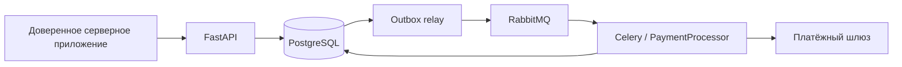

# Архитектура и гарантии

## Компоненты

API валидирует запрос, проверяет ключ повторного запроса, резервирует доступные средства при списании и сохраняет намерение обработки. Celery исполняет отдельные задачи; БД хранит состояние платежа. Outbox отвечает за доставку принятого намерения в брокер и восстановление обработки.

Доменный код задаёт правила денежных значений. Прикладные сценарии организуют транзакцию. HTTP, SQLAlchemy, RabbitMQ и платёжный шлюз реализуют внешние взаимодействия. У HTTP-обработчика и фонового обработчика отдельные жизненные циклы; общий изменяемый объект в памяти не является источником истины между ними.

## Деньги и резервирование

Все суммы относятся к одной расчётной валюте с двумя десятичными знаками. Конвертации валют нет. Валюта должна быть одинаковой в вызывающей системе и у шлюза.

`balance` — учтённый остаток счёта; `reserved_balance` — часть этого остатка, уже обещанная незавершённым списаниям. Доступная сумма равна `balance - reserved_balance`.

Для списания `amount` с комиссией `commission`:

1. Под блокировкой строки пользователя проверяется доступная сумма.
2. При принятии увеличивается только резерв на `amount + commission`.
3. При подтверждённом успехе на эту сумму уменьшаются баланс и резерв.
4. При подтверждённом отказе уменьшается только резерв.
5. При неизвестном результате резерв сохраняется до выяснения результата.

При пополнении подтверждённый успех увеличивает баланс на `amount - commission`. Комиссия сохраняется в платеже при принятии запроса, поэтому изменение ставки не меняет ранее принятые операции.

Суммы передаются строками, например `"100.00"`. Входные суммы с более чем двумя знаками, бесконечные значения, NaN и неположительные суммы отклоняются. Комиссия округляется отдельно до двух знаков по `ROUND_HALF_UP`. Значения ограничены точностью `NUMERIC(12,2)`.

## Повторные запросы

Ключ имеет область действия пользователя. Один ключ связывается с одной операцией и суммой. Повтор с той же операцией и суммой возвращает исходный платёж; изменение суммы или типа операции вызывает конфликт. Повтор отклонённого из-за остатка списания не превращается в новую попытку после пополнения: для нового намерения нужен новый ключ.

Ключи платежей не удаляются фоновым сроком хранения. Если нужна политика архивирования, её срок должен покрывать бизнес-период повторов и срок хранения ключей провайдером.

## Надёжная доставка

В одной транзакции сохраняются платёж, транзакция учёта и запись outbox. После фиксации outbox relay публикует идентификатор платежа в RabbitMQ с подтверждением публикации.

Если процесс прерывается между публикацией и фиксацией её результата, сообщение может быть отправлено повторно. Это ожидаемое поведение доставки как минимум один раз. Обработчик проверяет конечное состояние и использует блокировки/аренду обработки; итоговое изменение баланса выполняется один раз.

Внешний HTTP-вызов выполняется без удержания транзакционных блокировок БД. Аренда ограничивает конкурирующую обработку; проверка токена аренды защищает от применения устаревшего результата. Отдельный стабильный `Idempotency-Key` шлюза привязан к `payment_id`.

Брокер и HTTP-таймаут не дают гарантии «списать ровно один раз» сами по себе. Без идемпотентности и проверки результата на стороне реального провайдера такую гарантию обеспечить нельзя.

## Неопределённый результат

Отсутствие ответа от провайдера не равно отказу в операции: деньги могли быть списаны до обрыва связи. Повтор выполняется с тем же ключом. После исчерпания допустимых попыток платёж остаётся в `processing`, в ошибке появляется `reconciliation_required`, автоматические попытки прекращаются и резерв сохраняется.

Оператор проверяет тот же идентификатор у провайдера и применяет подтверждённый исход через операционную команду. Освобождать резерв или создавать новый платёж только из-за таймаута нельзя. Подтверждённый отказ переводит платёж в `failed` и освобождает резерв; подтверждённый успех завершает учёт.

## Нагрузка

Скорость обработки зависит от времени ответа провайдера, ограничений провайдера, конкуренции за строки счёта, количества воркеров, пула соединений и ресурсов PostgreSQL/RabbitMQ. Увеличение числа воркеров не снимает эти ограничения.

Входной HTTP RPS, скорость окончательного завершения платежей и возраст старейшего ожидающего события измеряются отдельно. Высокий RPS при растущей очереди не означает, что обработка справляется с потоком. Измерения должны включать задержки p50/p95/p99 и проверку балансов после повторов и сбоев.
